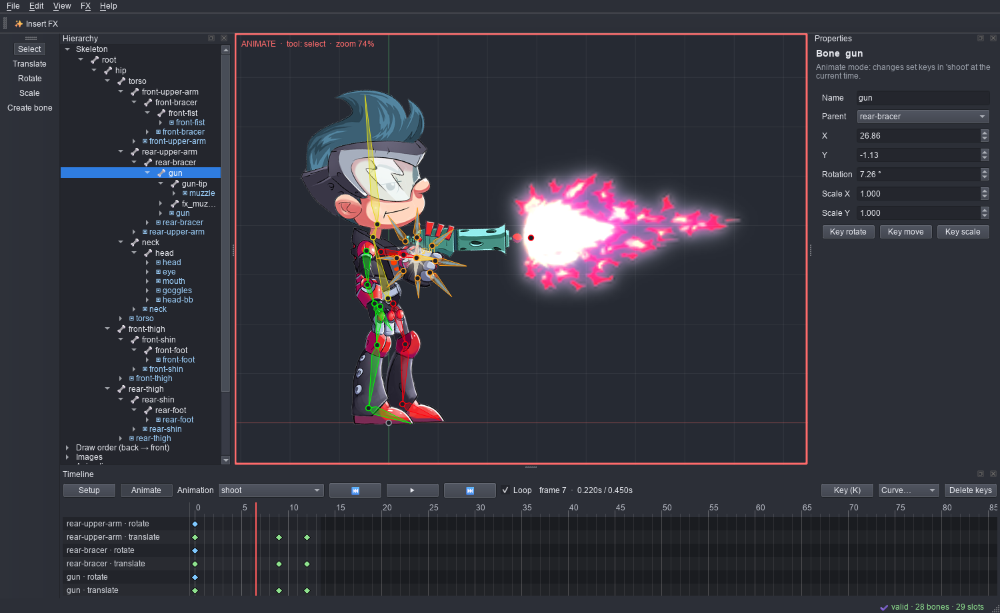

<div align="center">


# Anim2D

**A free, open-source 2D skeletal animation editor and FX builder for Windows.**

[](https://github.com/turtlegameworks/Anim2D/actions/workflows/ci.yml)
[](https://github.com/turtlegameworks/Anim2D/releases)
[](LICENSE)


[Download](#install) · [Editor guide](docs/editor.md) · [FX presets](docs/fx_presets.md) · [Contributing](CONTRIBUTING.md)

</div>



Anim2D lets you rig and animate 2D characters with bones, meshes and constraints, then export them for
major game engines and runtimes (Unity, Godot, Cocos, Phaser, Pixi, libGDX and more). It also comes
with an FX builder that turns 37 ready-made effects into editable skeletons you can tweak, insert into
a character, or export straight into your project.

It is a single Windows program with two modes:

* **Anim2D**, the editor. Bones, slots, region and mesh attachments, IK / transform / path constraints,
  skins, weight painting, mesh tracing, a dopesheet and graph editor, crossfade preview, texture packing
  and GIF / MP4 / PNG-sequence export.
* **Anim2D FX Builder**. Pick a preset (impacts, slashes, explosions, coin bursts, hearts, level-ups,
  UI pings…), adjust it with live preview, and generate a Spine package or insert it straight into the
  editor.

## Features

| | |
| --- | --- |
| **File formats** | Opens skeletal animation JSON and binary project files across established format versions. Exports JSON or binary `.skel` with an optional packed `.atlas` |
| **Rigging** | Bones with shear and inheritance, slots, draw order, skins with their own bones and constraints, IK, transform and path constraints, bounding boxes, clipping, points |
| **Meshes** | Mesh editing and tracing from alpha, weight painting, a Spine-style weights view, linked meshes, deform keys |
| **Animation** | Dopesheet and bezier graph editor, ease presets, retiming, motion paths, onion skinning, crossfade preview, events with audio, reference footage for rotoscoping |
| **Tools** | Auto-rig, physics baking, mirror, pose tools, frame sequences, PSD / OpenRaster import with live resync, command search, customisable shortcuts, themes |
| **Export** | Texture packer and unpacker, GIF, APNG, WebP, MP4, AVI, MOV, PSD and PNG / JPEG sequences, plus a Unity bridge that exports straight into a spine-unity project |
| **FX** | 37 parametric presets ([catalogue](docs/fx_presets.md)), your own templates registered from Spine exports ([round trip](docs/template_round_trip.md)), deterministic seeded generation |

## Install

1. Download `Anim2D-Setup-<version>.exe` from the [latest release](https://github.com/turtlegameworks/Anim2D/releases/latest).
2. Run it and pick what you want: **Anim2D** (the editor), **Anim2D FX Builder**, or both (the default).
   It installs for your user only, so it doesn't need administrator rights, into
   `%LOCALAPPDATA%\Programs\Anim2D`, with Start-menu shortcuts and desktop shortcuts if you want them.
   Running it again on a machine that has Anim2D updates that installation in place.

The builds are not code-signed yet, so Windows SmartScreen may say *"Windows protected your PC"* the
first time. Choose **More info → Run anyway**. Each release lists SHA-256 checksums in
`SHA256SUMS.txt` if you want to verify the download.

**Updates.** Anim2D checks GitHub for a new release once a day. When there is one, it tells you what's new;
**Install update** downloads it, checks it against the release's checksums, asks you to save your work, and
restarts on the new version. You can also skip a version, check by hand with **Help → Check for Updates…**,
or turn the daily check off in **Settings → Updates**. The check only asks GitHub for the latest release.

To uninstall, use Windows **Settings → Apps → Installed apps**, or *Uninstall Anim2D* in the Start
menu. Your projects are always kept. Two options, both off unless you tick them, also remove your
settings and downloaded updates, and your FX templates (`Documents\Anim2D Templates`).

Prefer not to install? Each release also has `Anim2D-Portable-<version>.exe`: one file that runs as is,
with no shortcuts or uninstall entry. Run it with `--fx-builder` to open the FX builder.

macOS and Linux builds aren't available yet. Running from source (below) may work there, but only
Windows is tested.

## Quick start

1. **File → Import Project…** opens a Spine JSON export or `.spine` project. Or start a new skeleton and
   use **File → Set Images Folder…**.
2. Build bones in **Setup** mode, attach images to slots, and switch to **Animate** (`Ctrl+Tab`) to key
   poses on the timeline.
3. **File → Save** writes an `.anim2d` project. **File → Export…** (`Ctrl+E`) writes data for your engine.
4. **FX → Insert FX into skeleton…** (`Ctrl+I`) drops a generated effect onto a bone at the current time.

The [editor guide](docs/editor.md) covers every panel, tool and shortcut.

## Run from source

You need Windows, [Python 3.11+](https://www.python.org/downloads/) (CI uses 3.11 and 3.13) and Git.
Node.js 22 is optional: it's only used by the runtime-parity tests.

```bash
git clone https://github.com/turtlegameworks/Anim2D.git
cd Anim2D
python -m venv .venv
.venv\Scripts\python -m pip install -e .[dev]
```

| Command | What it opens |
| --- | --- |
| `.venv\Scripts\anim2d` | the editor (`anim2d path\to\project.anim2d` opens a project) |
| `.venv\Scripts\anim2d-fx-builder` | the FX builder |
| `.venv\Scripts\anim2d-fx` | the FX command line (below) |

### FX command line

```bash
anim2d-fx list
anim2d-fx show impact_basic
anim2d-fx generate impact_basic --name fx_impact_01 --out output --set ray_count=12 --set primary_color=3aa0ff
anim2d-fx generate impact_basic --variant output\fx_impact_01\fx_impact_01.settings.json --name fx_impact_02 --out output
anim2d-fx register path\to\export.json --id my_hit --name "My Hit"
```

Each package holds the Spine JSON, its images, the settings that reproduce it, a generation report and
`IMPORT_IN_SPINE.md`. Existing folders are never overwritten. See [preset authoring](docs/preset_authoring.md)
to write your own presets.

### Tests

```bash
.venv\Scripts\python tools\fetch_spine_runtime.py
.venv\Scripts\python -m pytest
```

`fetch_spine_runtime.py` downloads pinned runtime fixtures for the format-parity tests; without Node.js
or that step, those tests are skipped. Some tests look for project files you already have locally and
skip if they are not available (see `ANIM2D_SPINE_EXAMPLES` and `ANIM2D_SPINE_PROJECTS`).

### Build the Windows program

```bash
.venv\Scripts\python -m pip install -e .[build]
.venv\Scripts\python tools\build_exe.py
```

This writes `dist\Anim2D.exe` and `dist\Anim2D-Setup-<version>.exe`. `tools\self_test.ps1` runs the
built program's own checks. CI does all of this on every push, and pushing a `v<version>` tag
publishes a release.

## Project layout

```text
src/anim2d/
  editor/          the editor: document model, viewport, panels, timeline, tools, exporters
  formats/         skeletal animation formats, atlas packer, project file reader
  preview/         pose evaluator, constraint solver, mesh and Qt renderer
  generation/      FX generators and registry
  models/          FX effect model, parameters, presets, settings and variants
  presets/         preset library discovery
  spine_adapters/  format adapters for FX package export
  templates/       registering Spine exports as FX templates
  packaging/       FX package and engine export
  validation/      output checks
  ui/              FX builder window
  preset_library/  the built-in presets (data and art only)
  assets/          icon
installer/         per-user Windows installer and uninstaller
tools/             build, self-test, runtime fetch, and art/icon generators
tests/             pytest suite (runs headless)
examples/          sample FX packages
docs/              guides, compatibility record, audit, screenshots
```

## Contributing

Bug reports, ideas and pull requests are welcome. Start with [CONTRIBUTING.md](CONTRIBUTING.md). Every
pull request gets CI and an automated [CodeRabbit](https://coderabbit.ai) review. Known gaps are tracked
in the issues. To report a security problem, see [SECURITY.md](SECURITY.md).

## License

Anim2D is released under the [MIT License](LICENSE). The presets' art is original and covered by the
same licence.
