# Anim2D

A 2D skeletal animation editor that reads Spine 3.8 and 4.0 JSON and exports **Spine 4.0 JSON or
binary (.skel)**, or Spine 3.8 JSON, with a texture packer and the FX library built in. Exports
play in Spine 4.0 runtimes such as spine-unity 4.0 (or 3.8 runtimes when exported as 3.8).

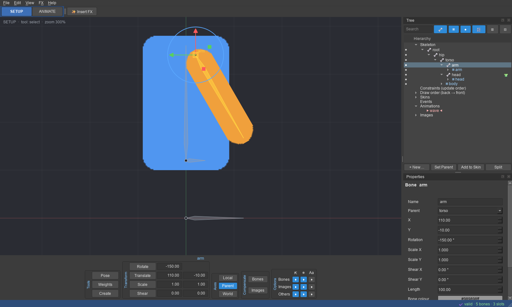

```bash
.venv\Scripts\anim2d
.venv\Scripts\anim2d path\to\skeleton.json      # open a Spine 3.8 or 4.0 JSON export
.venv\Scripts\anim2d path\to\project.anim2d
```

## Layout

| Area | What it does |
| --- | --- |
| SETUP / ANIMATE (top left) | Switches mode (**Ctrl+Tab**). Each mode has its own layout; see [Setup and Animate](#setup-and-animate) |
| Tool bar (bottom of the viewport) | **Tools** (Pose, Weights, Create), **Transform** (Rotate, Translate, Scale, Shear with their values and, in Animate mode, key buttons), **Axes**, **Compensate**, **Options**; see [Tool bar](#tool-bar). Keys: Translate **W**, Rotate **E**, Scale **R**, Shear **Q**, Pose **P**, Weights **Shift+W**, Create **C**, Select (all gizmos) **V**; any key can be changed (see [Keyboard shortcuts](#keyboard-shortcuts)) |
| Tree (right) | The hierarchy, with search, filters, an eye column, skin marks and the **New… / Set Parent / Add to Skin / Split** buttons; see [Tree](#tree). Properties of the selection sit below it |
| Viewport | Right/middle drag to pan, wheel to zoom, **F** to frame all. **View → Appearance…** (the Appearance page of Settings) sets the interface theme (Studio Grey, Midnight, Charcoal, Light, Ocean), the viewport background (Default, Charcoal, Slate, Mid grey, Light, Checker or any colour) and the grid (Subtle, Blueprint, High contrast, Warm, Dots, any colour, or Off), shown live and kept between sessions; **View → Grid** switches the grid quickly. The FX Preset Builder uses the same theme. 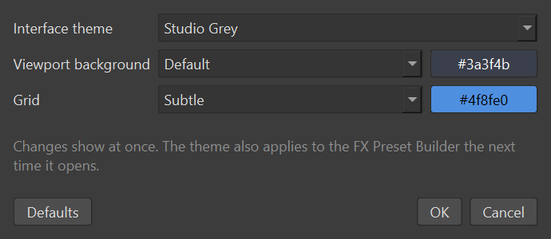 The **zoom bar** on the left has + / slider / −, 🔍 (100%) and ⛶ (fit). The selection shows a [gizmo](#gizmos). Red border = Animate mode |
| Weights (left, opens with the Weights tool) | See [Weights view](#weights-view) |
| Properties (under the tree) | Edit the selection. In Animate mode, bone, slot colour and attachment changes become keys |
| Timeline (Animate mode) | **Skin** picker (with **This skin only**: the animation list shows the chosen skin's animations, matched by name, `L1_intro` → skin `L1`, plus those of no skin; choosing a skin's animation shows that skin), animation picker, play/loop, curve presets, and a **Dopesheet** or **Graph** view (see [Animating](#animating-dopesheet-graph-and-preview)) |
| Dopesheet, Graph (Animate mode) | Separate windows: key timing in the Dopesheet, values and bezier handles in the Graph (tabbed under the Timeline at first). **Auto Key** in the Timeline: on, changes become keys at once; off, changes show until you move in time and **Key (K)** keeps them |
| Moving windows | Every window (Tree, Properties, Timeline, Dopesheet, Graph, Preview, Weights) can be dragged to any side, stacked as tabs, floated or closed, and made bigger or smaller by dragging its edge (controls that no longer fit scroll); View menu reopens them and **View → Reset window layout** puts them back. Each mode remembers its own arrangement |
| Preview (left, Animate mode) | A second viewport that plays animations on its own (View → Preview, Ctrl+Shift+P), on a checkerboard, with its own zoom bar |

The window uses a dark grey theme with blue highlights. The arrangement follows Spine's; the
icons and drawing are Anim2D's own.

## Tool bar

The bar along the bottom of the viewport shows the selected bone's (or region's) name, then:

* **Tools:** Pose, Weights and Create.
* **Transform:** Rotate, Translate, Scale and Shear.
  * Each row is the tool button plus its values. Type a value and press Enter to set it.
  * In Animate mode, a ◆ key button keys that property: green when it is keyed at this frame,
    yellow when it is keyed elsewhere.
* **Axes:** **Local** (the bone's own axes), **Parent** (the parent's axes) or **World**.
  * Sets the directions of the translate gizmo's arrows.
  * World also shows (and takes) world position and rotation in the Translate and Rotate values.
* **Compensate** (Setup mode): **Bones** keeps the child bones where they are when you transform
  a bone; **Images** keeps its images where they are. Works for gizmo drags, typed values and
  Properties.
* **Options:** for Bones, Images and Others (shapes and constraints), whether they can be
  **selected** in the viewport, are **visible**, and show their **names**.

## Tree

* **Search** shows matching items with their parents. The filter buttons show or hide bones, slots,
  attachments and constraints. ⊞ / ⊟ expand or collapse everything.
* **Eye column:** click ● to hide a bone (with its child bones and slots) or a slot in the viewport,
  ○ to show it again. This only affects the editor; exports are unchanged.
* **Skin column:** 👕 marks skin-only bones and constraints. The tooltip lists the skins.
* **Skin placeholders:** when other skins exist, a slot lists each placeholder (an attachment name
  the skins fill in) with an entry per skin. Click one to edit that skin's attachment.
* **New…** offers what fits the selection:
  * a bone or slot;
  * for a slot: a skin placeholder, bounding box, clipping, path or point;
  * for a bone: an IK, path or transform constraint;
  * a skin, animation or event.
* **Set Parent** moves a bone under another bone (it keeps its place), or a slot to another bone.
* **Add to Skin** makes the selected bone or constraint part of the skin being edited (or one you
  pick).
* **Split** cuts a bone in two at its middle. The new end bone takes over the children, and nothing
  moves.
* Bone Properties also have **Inherit rotation / scale / reflection**. These are Spine 4.0's
  transform modes; reflection only counts when rotation is inherited and scale is not.
  **Select** sets whether the bone can be picked in the viewport.

## Setup and Animate

Like Spine, Anim2D has two modes with their own interface:

* **SETUP** (blue): build the skeleton (the setup pose). There is no timeline, so the viewport is
  larger. Every change edits the setup pose.
* **ANIMATE** (red): the timeline, dopesheet and graph editor are at the bottom and the Preview is
  on the right. The viewport has a red border. Every change sets a key in the current animation
  at the current time.

Each mode remembers its own layout: show, hide or move panels in one mode and they stay that way
the next time you switch to it. In Animate mode the tool strip has a key button (◆) beside
Translate, Rotate, Scale and Shear that keys that property of the selected bone. The button is
**green** when the property has a key at the current frame, **yellow** when it has keys elsewhere
in the animation, and grey when it has none.

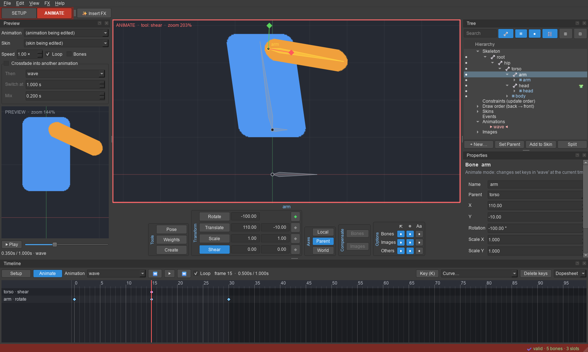

## Gizmos

The selected bone (or region attachment) shows a gizmo. Drag a handle to change only what it
controls:

| Gizmo | Handles |
| --- | --- |
| Translate (T) | Red arrow: X only. Green arrow: Y only (both along the parent's axes). Yellow centre square: free |
| Rotate (R) | Blue ring: rotate |
| Scale (S) | Red box: scale X. Green box: scale Y (along the bone's own axes). Yellow centre box: both |
| Shear (H) | Red diamond: shear X. Green diamond: shear Y |
| Select (V) | Translate arrows, rotate ring and scale boxes together |

The handle under the mouse turns white. Dragging the bone itself (not a handle) still works as
before with the active tool. Shear is also in Properties (Shear X / Y) and has its own keys.
Region attachments have no shear, as in Spine.

## Typical workflow

1. **File → Set images folder…** to a folder of PNGs. They appear under *Images*.
2. Select `root`, press **C**, and drag in the viewport to create bones; each new bone becomes the parent of the next.
3. Select a bone and double-click an image to give it a slot with that image. Move, rotate or scale
   the attachment with the tools while in Setup mode.
4. Create an animation (Edit → New animation, or right-click *Animations*) and switch to **Animate**.
5. Scrub to a frame and pose bones with T/R/S. Keys are set automatically, or press **K** to key
   the selected bone's current pose. Change slot colour or attachment in Properties to key them.
6. Select keys and pick a curve (Linear, Stepped, Ease in/out/in-out). Drag keys to retime them.
7. **File → Save** writes a `.anim2d` project (older `.rig2d` projects still open). **File → Export…** (Ctrl+E) writes the skeleton for the
   game: see [Export](#export).

## Animating: dopesheet, graph and preview

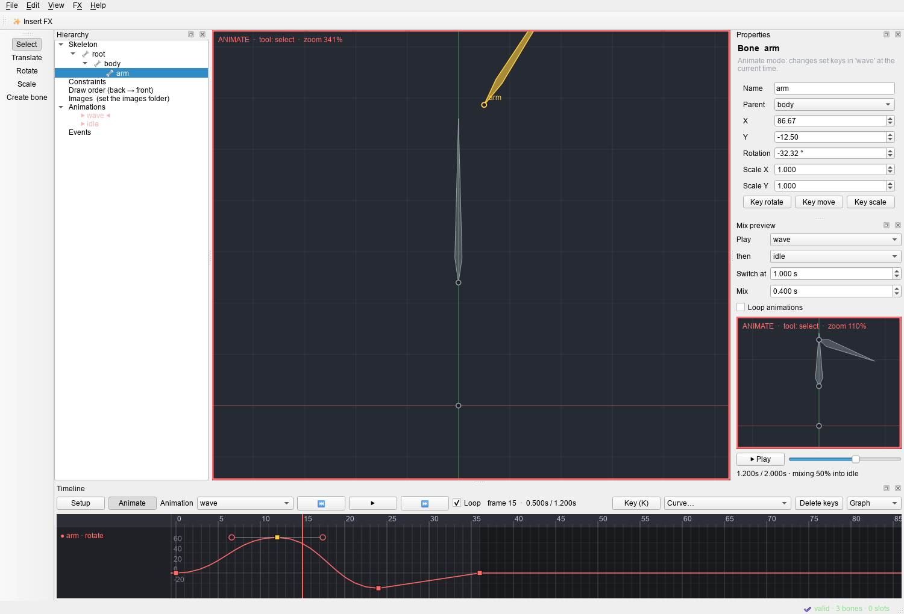

**Dopesheet**

* Click the ruler to scrub. Click a key to select it, Ctrl/Shift+click to add or remove.
* Drag in empty space to box-select keys (Ctrl/Shift adds to the selection). A plain click
  in empty space moves the playhead.
* Drag selected keys to retime them. **Del** deletes. **Ctrl+A** selects all keys.
* **Ctrl+C** copies the selected keys; **Ctrl+V** pastes them at the playhead. Times stay
  relative and curves keep their shape. Keys copied from one bone or slot paste onto the
  selected bone or slot, so you can reuse motion on another limb. Otherwise they go back
  onto the rows they came from. Pasted keys replace keys at the same times (events are added).
  Right-click for the same commands.
* Ctrl+wheel zooms time.

**Graph** (the *Dopesheet / Graph* switch on the timeline bar)

* Shows each value channel as a curve, for example rotate, x and y of translate, red to alpha
  of a colour, and IK mix and softness. It shows the rows of the selected keys, or every row of
  the selected bone, slot or IK constraint. Click a channel name to hide or show it.
* Drag a key point up or down to change its value. The curves around it keep their shape.
* Select a key to see its bezier handles: the outgoing handle and the previous segment's
  incoming handle. Drag them to shape the curve. Each channel has its own handles, as in Spine 4.0.
  Handle times stay inside their segment.
* To shape a linear or stepped segment, choose **Curve → Bezier (edit handles in the graph)**.
  This gives straight-line handles that do not change the motion until you drag them.
* Double-click a curve to add a key there without changing the motion: the bezier segment
  is split in two (de Casteljau). The game samples each segment at 9 points, so after a split
  the motion follows the true curve slightly more closely (well under 1% of the value range).
* Wheel zooms values, Ctrl+wheel zooms time, middle-drag pans, **F** fits the curves.
* Deform rows show their 0 → 1 blend per segment; their handles can be edited, their values cannot.

**Preview** (shown in Animate mode; View → Preview)

* A second viewport, like Spine's Preview, that plays animations by itself while you edit.
  * By default it plays the animation being edited and follows the editor when you switch.
    You can also pick a fixed animation.
  * It loops at any speed (0.05–4×) and can show another skin. Bones are optional.
  * Pause and drag the slider to scrub.
* **Crossfade into another animation:** tick it and choose the animation to switch to, when to
  switch and the mix duration. This is what the game does with `setAnimation` on one track and
  that mix duration in `AnimationStateData`.
* During the mix every property moves from the first animation's pose to the second's. Anything
  an animation does not key counts as the setup pose. Rotation keyed by both takes the shorter
  way round. Attachments switch to the second animation's (or the setup attachment) at once,
  as in the runtime. The status line shows how far the mix has got.
* The preview has its own view (pan and zoom only), so it never changes the project.

## IK constraints

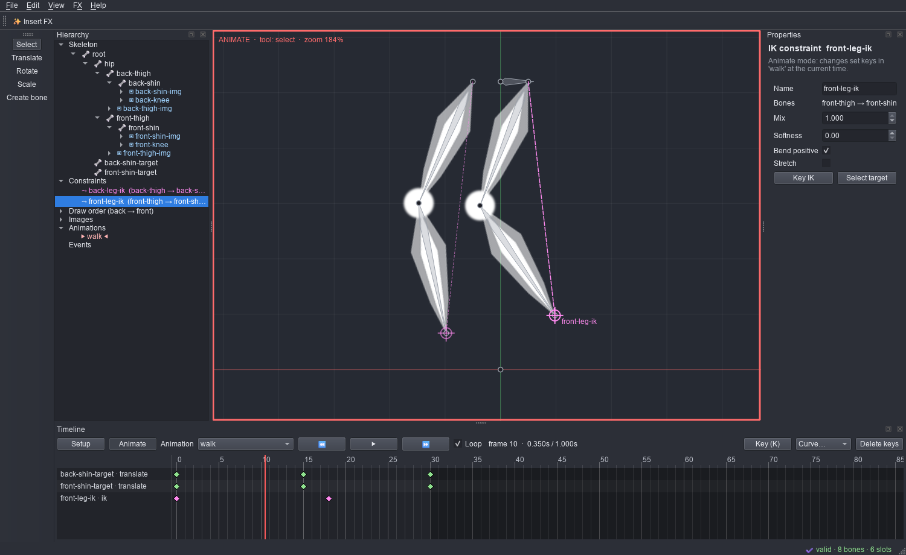

Select the bone at the end of a chain (a shin or forearm) and press **Ctrl+K**, or right-click it →
*Add IK constraint…*.

* **Bones**: one bone, or the bone and its parent (two-bone chain like thigh → shin).
* **Target**: an existing bone, or *New target bone at the chain tip*, which creates a target under
  the root so nothing jumps.
* Move the target bone (T) to pose the chain. Drawn in pink: a dashed line from the chain to a
  crosshair on the target.
* **Properties** (select the constraint in *Constraints*): target, mix, softness (two-bone), bend
  positive, stretch, compress and uniform (one-bone).
* **Animate mode**: changing mix, softness, bend, compress or stretch sets an IK key at the current
  time, and **K** keys the selected constraint. IK keys appear in the dopesheet and can be moved,
  deleted and given curves. Like Spine, mix and softness interpolate while bend, compress and stretch
  switch at each key.
* Renaming or deleting bones updates or removes the constraints that use them. Constraint orders stay
  contiguous (the runtime only applies orders 0..n-1).

Poses are solved with a port of the official Spine runtime's IK solver and update order,
including bone transform modes and shear. The editor therefore shows the pose the game will show.

## Meshes, weights and deform keys

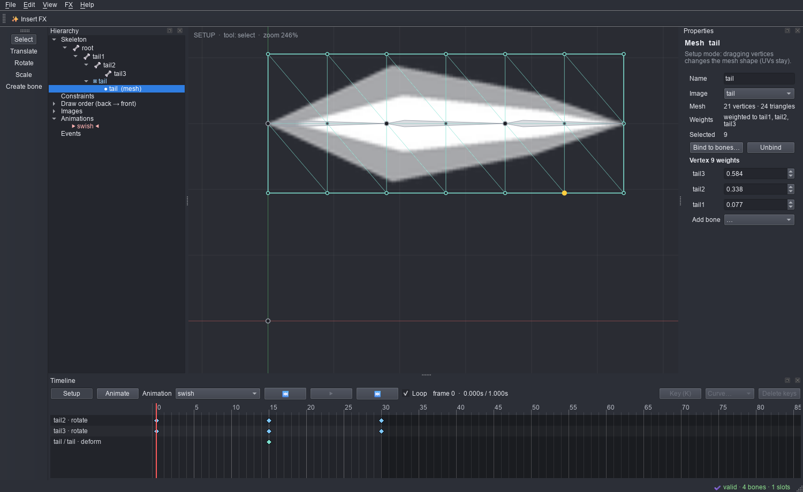

* **Create:** select a region attachment and click **Convert to mesh…** (columns × rows grid). The mesh
  keeps the same name, so existing attachment keys still work, and it looks exactly like the region.
* **Edit the shape (Setup mode):** select the mesh (or its slot) to see the wireframe. Click a vertex,
  or Ctrl+click to select several, then drag with Translate, Rotate or Scale. With no vertices
  selected, the whole mesh is transformed. UVs stay, so the image stretches with the vertices.
* **Add and remove vertices (Setup mode):** **Alt+click** inside the mesh to add an interior vertex,
  or on the outline to add an outline (hull) vertex. Select vertices and press **Delete** (or
  *Delete vertices*) to remove them. The outline needs at least 3 vertices. New vertices take
  their UV, weights and deform offsets from their neighbours, so nothing visibly changes. After each
  change the mesh is re-triangulated: a constrained Delaunay triangulation in image space that keeps
  the outline, including concave outlines. *Re-triangulate* does this on demand, for example
  for meshes imported from Spine. Re-triangulating replaces any custom internal edges from Spine.
* **Vertex drag mode (Setup mode):**
  * *Reshape*: vertices move and the image stretches with them.
  * *Edit mesh*: vertices and their UVs move together, so the image stays put and only the
    mesh layout changes.
  * *UVs only*: vertices stay and the image slides underneath them.

  New UVs are clamped to the image.

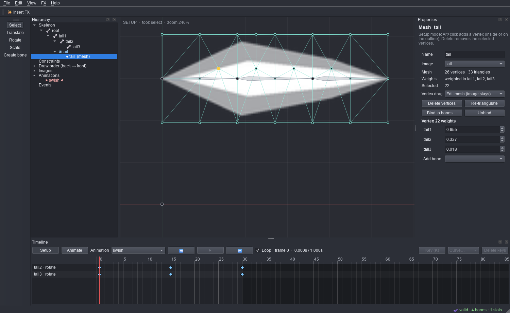

* **Weights:** *Bind to bones…* weights every vertex to the chosen bones by distance (up to 4 per
  vertex). Select one vertex to fine-tune it: set a bone's weight exactly and the others share the
  rest, or *Add bone*. *Unbind* returns to an unweighted mesh. The mesh never jumps while you do this.
* **Deform keys (Animate mode):** drag vertices to key the mesh shape at the current time. Other
  vertices keep their current deform. *Key deform* keys the current shape; *Key setup shape* keys no
  deform. Deform keys appear as `slot / attachment · deform` rows in the dopesheet and can be moved,
  deleted and given curves.
* Binding, unbinding or changing weights converts existing deform keys so the animation keeps its shape.
  Adding, reparenting or reordering bones keeps weights attached to the right bones. Deleting a
  bone that still weights a mesh is refused until you unbind or remove that weight.

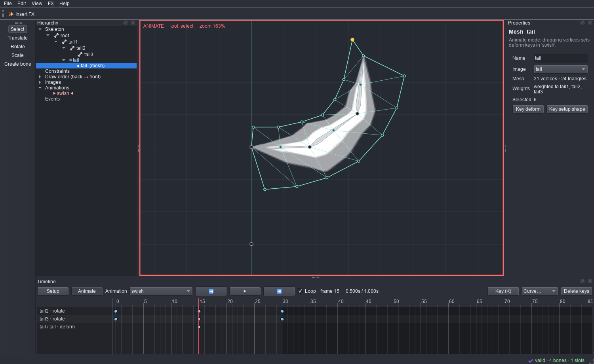

## Transform and path constraints

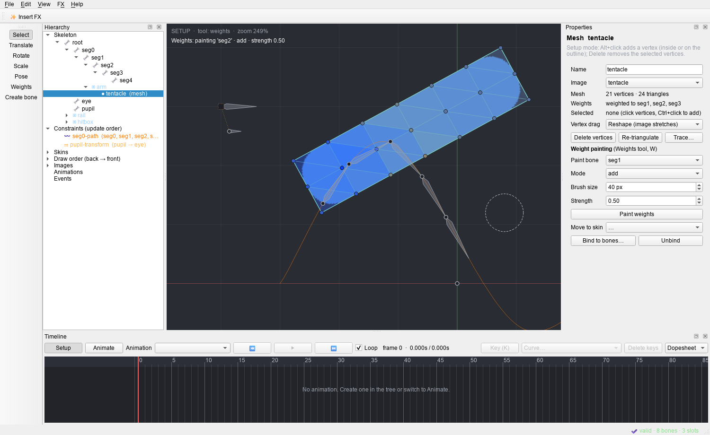

Right-click a bone → *Add transform constraint…* or *Add path constraint…* (or right-click
*Constraints*). Choose the constrained bones and the target.

* **Transform constraint:** the bones copy the target bone's rotation, position, scale and shear,
  each by its own mix (0–1). Properties sets the offsets and the modes: **Local** copies the
  target's local values instead of its world transform, and **Relative** adds them instead of
  matching. A dotted line joins the bones to their target.
* **Path constraint:** the bones are placed in order along the path attachment of the target slot.
  * **Position** is where the first bone sits (percent of the path, or fixed length).
  * **Spacing** separates the bones: *length* (bone length plus spacing), *fixed*, *percent* or
    *proportional*.
  * **Rotate mode:** *tangent* follows the path direction; *chain* aims each bone at the next;
    *chainScale* also stretches the bones to fit.
  * Mix rotate/X/Y blend the constraint in.
* **Animate mode:** the mixes (and a path's position and spacing) are keyed like IK; **K** keys the
  selected constraint. The keys show in the dopesheet and the graph editor.
* **Update order:** constraints are applied in the order listed under *Constraints*. Right-click
  → *Update earlier/later*. Orders stay contiguous, because the runtime skips gaps.
* Renaming or deleting a bone or slot updates or removes the constraints and skins that use it.
* **Solver:** every constraint is solved with a port of the official 4.0 runtime, so the editor
  shows the game's pose. This includes the runtime's own quirk in the scale of local, absolute
  transform constraints.

## Pose tool

**Pose (P):** drag a bone and it rotates, together with its parent, so that its tip follows the
mouse, like a temporary IK chain.

* **Shift**-drag rotates the bone alone; **Ctrl**-drag uses the whole chain up to the root.
* Only rotations change: the setup pose in Setup mode, rotate keys in Animate mode.
* One drag is one undo step.

## Shapes: paths, bounding boxes, clipping and points

Right-click a slot → *Add shape*. Shapes are drawn over the images (the game does not draw them),
and in Setup mode they are edited directly:

* **Path:** smooth points with handles (squares). Dragging a point carries its handles. **Alt+click**
  adds a point (beyond the last point it extends the path), **Delete** removes the selected
  points. *Closed* joins the ends; *Constant speed* moves bones along it evenly. The curve
  lengths the runtime needs are recomputed after every edit.
* **Bounding box** (hit areas for the game) and **clipping polygon**: drag vertices, **Alt+click**
  on an edge adds one, **Delete** removes the selected ones.
* **Clipping:** clips the slots drawn after it, up to and including *Clip until slot* (or the
  last slot). The viewport, the renders and the exports clip the same way.
* **Point:** a position and direction (for example a gun muzzle). Drag it with Translate and aim
  it with Rotate.

## Skins

Skins list under *Skins* in the hierarchy. **Double-click** a skin (or *Edit and show this skin*)
to **edit** it: the viewport then shows that skin on top of the default skin, and new attachments
go into it.

* Give an attachment in a skin the same name as one in another skin (the slot's setup attachment
  or attachment keys). Each skin then shows its own image in that slot, as in Spine.
* **Skin bones and constraints:** list them in the skin's Properties, or tick *Skin only* on a bone
  or constraint. They are only active while a skin that lists them is.
* New, rename, duplicate and delete skins. **Move to skin** moves an attachment and its deform keys
  to another skin.
* Deform keys belong to an attachment of a skin, so the dopesheet shows those of the edit skin.
* Linked meshes (common in imported rigs) draw with their parent mesh's shape and, with
  deform inheritance on, play the parent's deform keys.

## Weight painting and mesh tracing

* **Weights (Shift+W):** select a mesh and paint in the viewport; the [Weights view](#weights-view) opens
  with the tool.
  * Weights show as a heat map: red = 1, blue = 0.
  * **Add** and **Subtract** move the weight towards 1 or 0 by *Strength*. **Replace** sets it to
    *Strength*. **Smooth** evens each vertex out with its neighbours.
  * The brush fades towards its edge. The other bones share the remaining weight in proportion.
  * The mesh never moves while you paint, and deform keys keep their shape.
  * One stroke is one undo step. Unweighted meshes are weighted to their slot bone first.
* **Trace…** (Properties of a region or an unweighted mesh): builds a mesh from the image's alpha.
  * **Detail** is how far the outline may stray from the edge (lower gives more vertices).
  * **Padding** grows the outline outwards. **Alpha threshold** sets which pixels count as opaque.
  * **Interior spacing** adds vertices inside.
  * The traced mesh shows the image exactly where the region or mesh did.

## Weights view

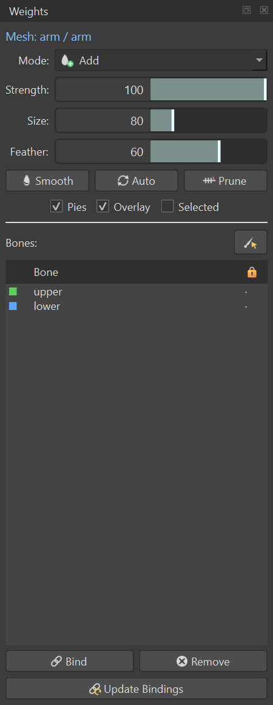

The Weights tool (Shift+W) opens the **Weights** view, laid out like Spine's.

* **Mode:** Add, Subtract, Replace or Smooth.
* **Strength:** how much each dab changes the weight.
* **Size:** the brush radius in screen pixels.
* **Feather:** how soft the brush edge is. The dashed inner ring is the full-strength core.
* **Smooth:** evens all weights out with their neighbours, once. **Auto:** weights from the distance
  to the bound bones, as Bind does. **Prune:** removes weights below a value and renormalises.
* **Pies** draws each vertex's bone weights as a pie in the bones' colours. **Overlay** colours the
  mesh by the painted bone's weights (red = 1, blue = 0). **Selected** limits painting, Smooth and
  Auto to the selected vertices.
* **Bones:** the bones the mesh is bound to, each with its colour.
  * Click a bone to paint it; the 🔒 column locks a bone so its weights do not change.
  * With the Weights tool, selecting a bone in the Tree or **Ctrl+clicking** it in the viewport
    also picks it. The mesh stays the one being weighted.
* **Bind** binds the mesh to the bones you tick. An unweighted mesh gets automatic weights; a
  weighted one gets the bones added with no weight, ready to paint.
* **Remove** takes the chosen bone out. Its weight goes to the vertex's other bones (or the nearest
  bound bone), and nothing moves.
* **Update Bindings:** after you move bones in Setup mode the bound mesh moves with them.
  Update Bindings puts the mesh back where it was at the last Bind and binds it to the bones
  where they are now.
  * Anim2D remembers the bind pose for this session only. After reopening a project, Bind
    again first.

## FX inside the editor

**FX → Insert FX into skeleton…** (Ctrl+I, or right-click a bone → *Insert FX here…*)

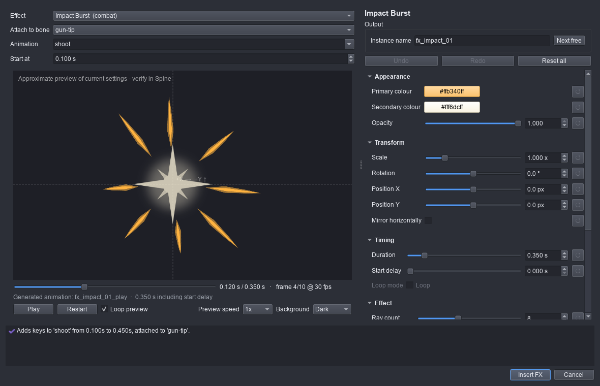

* Pick any built-in preset or one of your Spine templates, tune it with the same controls as the FX
  Preset Builder, and choose the bone, animation and start time.
* The effect is merged into the skeleton with its own prefixed bones and slots. Its root follows the
  chosen bone, its slots draw on top, and its images are copied to `images/<instance>/`. Its keys are
  added to the chosen animation; existing keys are never changed.
* It is ordinary skeleton data afterwards: select `fx_…_root` to move or aim it, edit or retime
  its keys, or delete it.
* One **Undo** removes the whole insertion. Image files already copied stay in the images folder.
* **FX → Import FX template from Spine export…** registers a Spine-edited effect;
  **FX → Open FX Preset Builder** opens the standalone tool.

## Rigging and animation tools

| Tool | Where | What it does |
| --- | --- | --- |
| Draw-order keys | Tree slot menu in Animate mode (Draw earlier/later/back/front, then key) | Keys the draw order at the current time; the draw-order group shows the animated order |
| Events | Tree event menu → Open the Events window (View → Events) | Events with int/float/string/audio/volume/balance defaults; keys at the current time, edited in place. **🔊 Audio folder…** sets where audio paths are found (default: an `audio` folder next to the images); **▶ Play sound** tries one |
| Event sounds | 🔊 next to Loop in the Timeline and Preview | Events with an audio path play their sound (WAV, MP3, OGG) when the playhead passes them; key volume overrides the event's. Balance is kept but not heard |
| Image sequences | Tree slot menu → Add image sequence… | Numbered images (`fire_01.png` …) become attachments keyed as a flip-book: frame rate, forward/reverse/ping-pong, repeats, keep or hide the last frame |
| Onion skin | Timeline 👻 Onion button (▸ menu: frames before/after, step, strength, selected only, in front) | Ghosts of nearby frames, red before and green after. With **Selected only** (on by default) only the selected bone and its children, or the selected slot, are ghosted; with nothing selected, everything is |
| Copy / paste pose | Edit → Copy pose (Ctrl+Shift+C), Paste pose (Ctrl+Shift+V), Paste pose mirrored (Ctrl+Alt+V) | Copies the selected bone and its children; mirrored pastes onto the other side's bones (`L_`/`R_`, `_l`/`_r`, `Left`/`Right`) |
| Mirror bones | Edit → Mirror bones… | Copies a bone chain with its slots and attachments, reflected across a vertical line; weighted meshes follow |
| Bake / Simplify | Edit → Bake constraints to keys, Simplify keys | Keys every frame with IK/transform/path applied and turns those constraints off in the animation; Simplify removes keys within 0.1° / 0.1 px |
| Animation layers | Preview → Layer on top | Plays a second animation on a track above: the timelines it keys replace the first animation's |
| Bone chains | Tree bone menu → Add bone chain…; path attachment menu → Bone chain along this path… | A chain out of the bone's tip (count, length, curl), or along a path's curve |
| Rig mesh | Tree mesh menu → Rig to the bones over it | Binds the mesh to the bones that reach it, weighted by distance |
| Physics | Tree bone menu → Physics…; Preview → Physics; Edit → Bake physics to keys | Springy bones (stiffness, damping, inertia, mass, gravity, wind, limit, mix) for hair, cloth and tails. The Preview simulates them; Spine 3.8/4.0 runtimes have no physics, so bake them to rotate keys before exporting (exports leave the constraints out and say so) |
| History | View → History | Every undo step; click one to go back or forward to it |
| Motion paths | View → Motion paths (Ctrl+Alt+M), Animate mode | The selected bone's path over the animation: a dot per frame, an orange diamond at each key. Drag a dot to move the bone at that frame (it sets the translate key there, whatever the parents do) |
| Ease presets | Timeline → Curve… | Ease in/out (normal and strong), Overshoot, Anticipate, Anticipate + overshoot for the selected keys. **Bounce** and **Elastic** add keys between each selected key and the next (bone timelines) |
| Copy / paste curve | Timeline → Curve… → Copy curve, Paste curve | Copy the shape after one key and give it to other keys, on any timeline |
| Retime | Edit → Retime… (Ctrl+Alt+T) | Scale time (speed factor or new length), reverse, or loop a section, for the whole animation or the selected keys; curves keep their shape |
| Live layer sync | File → Import PSD / OpenRaster… | Imported `.psd` and `.ora` files (Photoshop, Krita, GIMP) are followed: saving one updates the images in Anim2D, moving layers by as much as they moved in the file, so bones, weights, keys and your own moves stay. New layers become new slots. **File → Sync layered images now** does it by hand |
| Command search | Help → Search commands (Ctrl+Space) | Type part of any command's name and press Enter to run it |
| Reference footage (rotoscoping) | View → Reference footage… (Ctrl+Alt+R) | A video (MP4, MOV, AVI, WebM …), a numbered image sequence or one image behind the skeleton (or in front), at the frame matching the timeline time. Opacity, scale, position, start offset, speed, mirror; **Fit to view** and **Match animation length**. Saved with the project; the footage itself is not copied or exported |

## File menu

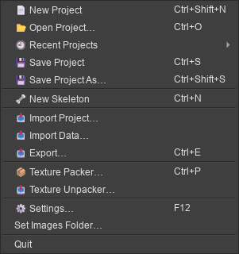

| Item | What it does |
| --- | --- |
| New Project (Ctrl+Shift+N) | An empty project |
| Open Project… (Ctrl+O), Recent Projects | Opens a `.anim2d` (or an older `.rig2d`). Recent Projects lists the last ones (Settings sets how many) |
| Save Project (Ctrl+S), Save Project As… (Ctrl+Shift+S) | Writes the `.anim2d` |
| New Skeleton (Ctrl+N) | An empty skeleton that keeps the current images folder (a new project) |
| Skeletons in project | Add, duplicate, rename, delete or switch between several skeletons in one project; they share the images folder and each has its own undo. Export writes the one being edited |
| Import Project… | Opens a Spine project (`.spine`, Spine 3.8.x or 4.2.x) or a Spine JSON export as a new project; see [Spine projects](#spine-projects-spine) |
| Import Data… | Adds another Spine project's or Spine JSON's bones, slots, constraints, skins, events and animations to the open skeleton. What already exists is kept; a clashing animation name gets a number. One Undo removes it |
| Import PSD… | Each Photoshop layer becomes an image (in a folder named after the PSD), a slot and an attachment placed where the layer sits; the canvas centre is the origin. 8-bit RGB or grayscale, uncompressed or RLE |
| Export… (Ctrl+E) | See [Export](#export) |
| Unity Bridge…, Export to Unity (Ctrl+Alt+E) | See [Unity bridge](#unity-bridge) |
| Texture Packer… (Ctrl+P) | Packs every PNG/JPEG in a folder (with subfolders) into an atlas; see [Texture Packer](#texture-packer) |
| Texture Unpacker… | Writes every region of a `.atlas` (4.0 or 3.8) back out as its own PNG, at its original size with whitespace and rotation restored and premultiplied alpha undone. A region with an index is written as `name_<index>.png` |
| Settings… (F12) | One window with a page per topic; see [Settings](#settings) |

**Autosave** (off by default) writes `<project>.anim2d.autosave` next to a saved project that has
changes, every N minutes. The project file itself changes only when you save.

## Settings

**File → Settings…** (F12) opens every preference in one window, a page per topic. OK keeps the changes;
Cancel puts Appearance back the way it was.

| Page | What's on it |
| --- | --- |
| General | Recent projects count (and Clear recent projects), undo levels, FPS of new skeletons, autosave, and **Folders**: where projects, FX templates, FX output and the log are, each with an Open button |
| Appearance | Interface theme, viewport background and grid, shown live (also **View → Appearance…**) |
| Shortcuts | Opens the keyboard shortcut editor and the list of current keys |
| Updates | Your version, the last check, **Check now**, **Install update** when one is waiting, the daily check on or off, and stop skipping a version you skipped |
| Plugins | The built-in integrations for now: the Unity bridge and your FX templates folder. Plugin support is planned |
| About | Version, links to the website, bug reports and release notes, the licence, and **Copy system info** for bug reports |

**Updates.** Installed copies check GitHub once a day, a few seconds after starting. When a release is
out, a dialog shows its notes, and an **⬆ Update to …** button stays in the status bar. **Install
update** downloads the installer, checks it against the release's SHA-256 checksums, asks to save your
project, closes Anim2D, and the installer updates it in place, keeping the apps and shortcuts you chose,
then starts it again. **Skip this version** stops it being offered until a newer one is out;
**Help → Check for Updates…** always shows it. If there's no connection, the daily check stays quiet and
Settings → Updates says what went wrong. The portable program downloads the new portable program next to
itself instead; running from source never checks by itself.

## Keyboard shortcuts

**Edit → Keyboard Shortcuts…** (Ctrl+Alt+K) lists every command with its key. Click a key and press
the new one, or clear it; a key used twice is refused. **Reset all** restores the defaults. The
keys are kept between sessions; **Help → Shortcuts** shows the current ones. The **Help** menu also has
**Check for Updates…**, **Report a Bug…** and **About Anim2D**.

**Space** (Edit → Deselect) clears the selection: bones, slots, attachments, mesh vertices and
selected keys. In a text box Space still types a space.

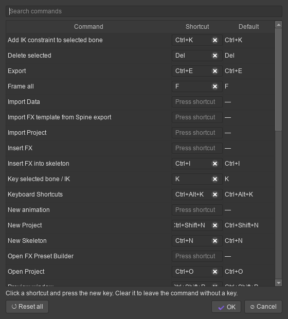

## Spine projects (.spine)

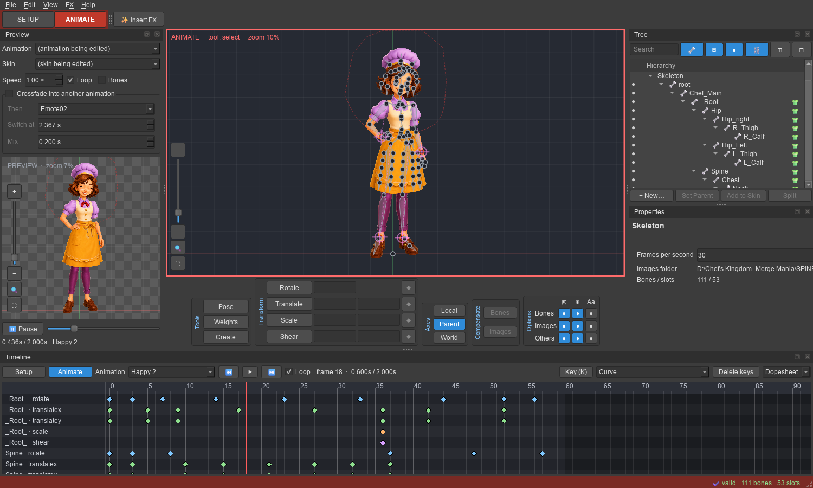

**File → Import Project…** opens Spine editor project files directly, so you can carry on with
a project without exporting it from Spine first.

* **Spine 3.8.x** (tested with 3.8.55 and 3.8.75): bones, slots, skins and skin folders, region,
  mesh, linked mesh, bounding box, path and clipping attachments with weights, IK,
  transform and path constraints with their order, events, and every animation timeline
  (bones, slot colours and attachments, deform, draw order, events, constraints).
* **Spine 4.2.x** (tested with 4.2.43): the same setup data, and animations with their 4.x
  per-channel bezier curves, stepped keys, colours, attachments, deform, IK and draw order.
  4.2's constraint order and physics constraints are not imported.
* Setup values come from the setup pose, even if the project was saved in Animate mode.
  Attachments whose **Export** box is off in Spine are left out, as Spine's export does.
* The images folder is the one the project names (usually `./images/` next to the `.spine`).
* A project with several skeletons imports the first one.
* Point attachments and other classes none of the test projects used are not decoded yet; such a
  project reports what it could not read instead of importing partly.
* Other Spine versions (2.x, 3.0–3.7, 4.0, 4.1): export JSON from Spine and import that instead.

Spine does not publish the `.spine` format. Anim2D reads it from how Spine writes its projects,
and checks the result against Spine's own exports: see [Verification](#verification).

## Export

**File → Export…** (Ctrl+E). Choose a format on the left; its options are on the right.

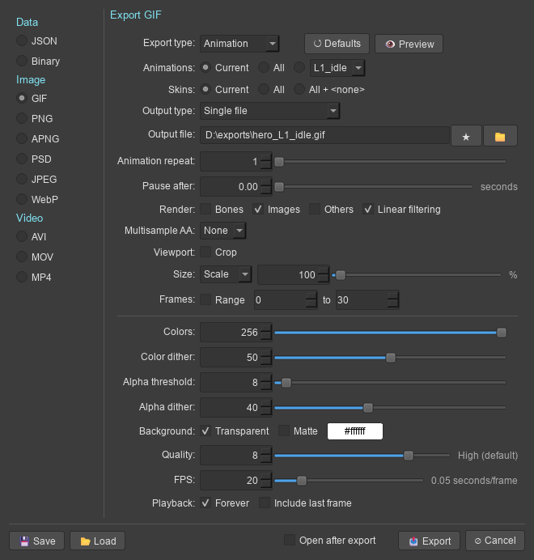

* **Save / Load** write and read the dialog's settings as a file.
* Each format remembers its own settings between exports.
* **Open after export** opens the file (or the folder, for many files) when done.

### Data: JSON and Binary

| Option | Choices |
| --- | --- |
| Output folder, Extension | The file is `<folder>/<project name><extension>` (`.json` or `.skel` by default). ★ keeps favourite folders |
| Format | **JSON**, or **JavaScript**: names without quotes (smaller; not strict JSON). **Pretty print** indents |
| Version | **Spine 4.0** (`4.0.64`, default). **Spine 3.8** (`3.8.99`): 3.8 runtimes. **Spine 3.8.75**: importing into the Spine 3.8.75 editor (official 3.8 runtimes refuse data stamped `3.8.75`). Binary is 4.0 only |
| Nonessential data | Off leaves out what only the editor uses: fps, images path, bone and shape colours, mesh edges and sizes |
| Animation clean up | Leaves out keys that change nothing (a key equal to its neighbours where the curves are linear or stepped). The motion is unchanged |
| Warnings | Shows the export's notes |
| Texture atlas: Pack | Packs the images into `<name>.atlas` and pages instead of copying them to `images/`. **Pack settings…** opens the [Texture Packer settings](#texture-packer) |

**3.8 export:** some Spine 4.0 curves and timelines have no exact 3.8 form. Examples are split
X/Y timelines, separate RGB and alpha timelines, and curves whose handles differ per channel.
These are converted to extra linear keys, so 3.8 plays the same motion within 0.01 px or degree.
The export lists what was converted.

### Image and video

Formats: **GIF**, **PNG** (one file per frame, or packed into an atlas), **APNG**, **PSD** (one
layer per frame, the first on top), **JPEG** (one file per frame), **WebP**, **AVI** (Motion JPEG,
or uncompressed with alpha), **MOV** (PNG with alpha, or JPEG) and **MP4** (H.264).

| Option | What it does |
| --- | --- |
| Export type | **Animation**, **Current pose** (the timeline's time) or **Setup pose**. **Defaults** resets the format; **Preview** plays what will be written |
| Animations | **Current**, **All**, or the one chosen in the list |
| Skins | **Current**, **All**, or **All + <none>** (also without a skin) |
| Output type | **Single file** (everything in one file) or **File per animation and skin** (`name_<animation>_<skin>`) |
| Output file / prefix | One file, or the prefix of the frame files (`prefix_0000.png` …) |
| Animation repeat, Pause after | Plays the animation N times; holds the last frame for N seconds |
| Render | **Bones**, **Images**, **Others** (bounding boxes, clipping, paths, points), **Linear filtering** (off: nearest pixels) |
| Multisample AA | Renders 2x–16x larger and scales down for smoother edges |
| Viewport: Crop | Exports only the area the viewport shows |
| Size | **Scale** (percent of world size), **Width** or **Height** in pixels |
| Frames: Range | Only frames N to M |
| Colors, Color dither, Alpha threshold, Alpha dither, Quality (GIF) | Palette size; dithering on or off; pixels below the alpha threshold become transparent, with ordered dithering of the soft edges; quality picks the palette method |
| Background | **Transparent**, or a colour. GIF **Matte** blends soft edges toward a colour. JPEG, MP4, Motion JPEG AVI and JPEG MOV always have a background |
| Compression (PNG, APNG, MOV PNG), Quality (JPEG, WebP, AVI, MOV JPEG) | |
| FPS, Playback | Frames per second; **Forever** loops (GIF, APNG, WebP); **Include last frame** adds the frame at the animation's end |
| Texture atlas: Pack (PNG, JPEG) | Packs the frames into an atlas; with **Use indexes** each frame is one region with an `index` |

* Frames use the editor's renderer. Blend modes are approximate.
* AVI, MOV and PSD files are written by Anim2D itself; MP4 uses the H.264 encoder Windows
  provides, through Qt Multimedia. No extra software is needed.
* JPEG-based video is padded to an even width and height with the background colour.
* Anim2D has no audio, so videos have no sound.

## Unity bridge

**File → Unity Bridge…** exports straight into a Unity project for spine-unity: choose the project
folder (the one with `Assets/`), a folder in `Assets` (default `Assets/Spine`), the spine-unity
version (4.0 or 3.8; detected when spine-unity is installed), premultiplied alpha and atlas scale.
Each skeleton goes to its own subfolder as `<name>.json`, `<name>.atlas.txt` and the atlas PNGs,
which spine-unity turns into a SkeletonData asset. With **Export to Unity every time the project
is saved** on, saving also exports; **Export to Unity** (Ctrl+Alt+E) exports at any time. The
settings are saved in the project.

Unity notices the new files when it comes to the front. **Install auto-refresh script in Unity**
adds `Assets/Editor/Anim2DBridge.cs`, which refreshes Unity's assets after each export even while
it is in the background (delete the file to stop it).

## Texture Packer

**File → Texture Packer…** (Ctrl+P) packs a folder; **Pack settings…** in the Export dialog uses the
same settings.

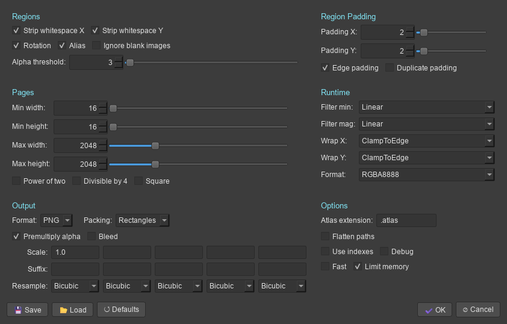

| Section | Settings |
| --- | --- |
| Regions | **Strip whitespace X / Y** (crop transparent borders; the runtime puts the image back in place), **Rotation** (turn regions 90° when they fit better), **Alias** (identical images share one region), **Ignore blank images**, **Alpha threshold** (pixels at or below it count as whitespace) |
| Region Padding | **Padding X / Y** between regions; **Edge padding** (also around the page edge); **Duplicate padding** (repeat edge pixels into the padding) |
| Pages | **Min / Max width and height**, **Power of two**, **Divisible by 4**, **Square** |
| Runtime | **Filter min / mag**, **Wrap X / Y** (written as `repeat:`), **Format** (written as `format:`) |
| Output | **Format** PNG or JPG pages, **Packing** Rectangles (MaxRects) or Grid, **Premultiply alpha** (`pma: true`; turn PMA on in the runtime too), **Bleed** (transparent pixels take their neighbours' colour), up to five **Scales** with a **Suffix** and **Resample** filter each (one atlas per scale) |
| Options | **Atlas extension**, **Flatten paths** (region names without folders), **Use indexes** (`run_3` → region `run`, `index: 3`), **Debug** (outlines the regions on the pages), **Fast** (one packing pass instead of trying three), **Limit memory** |

Region names are the image paths (`parts/arm`), as the Spine runtimes look them up. Spine's
**Polygons** packing is not available; Grid packing is.

## What is supported

| Feature | Status |
| --- | --- |
| Bones: create, rename, reparent (keeps world pose), delete, colour, length | ✅ |
| Slots: image region attachments, colour, blend mode, draw order | ✅ |
| Animation: rotate / translate / scale keys (shear kept), colour and attachment keys, events, curves | ✅ |
| Undo/redo for every edit, project save/load | ✅ |
| Dopesheet box select, select all, copy/paste of keys (onto other bones), retiming | ✅ |
| Graph editor: per-channel curves, key values, bezier handles, adding keys on a curve | ✅ |
| Preview: plays animations on its own (speed, loop, skin), crossfades like the runtime's AnimationState | ✅ |
| Setup / Animate interfaces with their own layouts; key buttons per transform; gizmos for translate, rotate, scale, shear | ✅ |
| Spine-style tool bar (typed values, Local/Parent/World axes, compensation, select/visible/name options) and tree (search, filters, eye column, New…, Set Parent, Add to Skin, Split, skin placeholders, inherit flags) | ✅ |
| Spine 3.8 and 4.0 JSON import; 4.0 JSON and binary (.skel) export; 3.8 JSON export | ✅ |
| Texture packer: atlas pages, whitespace strip, rotation, padding, scale, power of two, premultiplied alpha | ✅ |
| FX presets and Spine templates inserted into a character animation | ✅ |
| Meshes: grid creation from regions, vertex editing, weights (auto bind, per-vertex), deform keys | ✅ drawn textured, solved like the runtime |
| Adding/removing mesh vertices (inside or on the outline), automatic re-triangulation, UV editing | ✅ |
| Custom internal edges, splitting triangles by hand | ❌ not yet (re-triangulating replaces Spine's custom edges) |
| Bounding boxes, points, clipping polygons, paths: create, edit, draw; clipping applied when drawing | ✅ |
| Linked meshes | ✅ drawn and solved (with inherited deform); edited through their parent mesh |
| Draw-order keys | ✅ keyed from the Tree, drawn, exported |
| Transform constraints (world/local, absolute/relative) and path constraints (all modes), keyed mixes | ✅ solved like the 4.0 runtime |
| Pose tool | ✅ |
| Skins: create, edit, duplicate, skin bones and constraints, per-skin deform keys | ✅ |
| Weight painting (add, subtract, replace, smooth) and mesh tracing from image alpha | ✅ |
| Weights view: strength / size / feather, Smooth, Auto, Prune, pies, overlay, selected-only, bone locks, Bind, Remove, Update Bindings | ✅ |
| Zoom bar (+ / − / slider / 100% / fit) on the viewport and Preview | ✅ |
| Export: JSON (or JavaScript), binary, nonessential data, animation clean up | ✅ |
| Image/video export: GIF, PNG (frames or atlas), APNG, PSD, JPEG, WebP, AVI, MOV, MP4; animations, skins, bones/others, MSAA, crop, size, range, repeat, pause | ✅ (no audio) |
| Texture Packer (all of Spine's settings except Polygons packing) and Texture Unpacker | ✅ |
| File menu: recent projects, New Skeleton, Import Data, Settings, autosave | ✅ |
| Import Spine projects (`.spine`) from Spine 3.8.x and 4.2.x | ✅ (4.2: no physics or constraint order) |
| IK constraints: one- and two-bone, mix, softness, bend, stretch, compress, uniform; keyed mix/bend/softness | ✅ |
| Shear, bone transform modes (only translation, no rotation, no scale …) | ✅ solved like the runtime (shear keys kept; not editable in Properties) |
| IK inside FX templates | ❌ templates with IK are rejected; build IK in the character instead |
| Events and audio events | ✅ Events window; sounds play during playback (no balance) |
| Image sequences, onion skin, pose copy/paste (mirrored), mirror bones, bake, simplify, animation layers in the Preview | ✅ |
| PSD import, bone chains, mesh auto-rig | ✅ (PSD: no ZIP-compressed layers, no 16-bit) |
| Physics constraints | ✅ simulated in the Preview, baked to keys for 3.8/4.0 runtimes |
| Undo History window, several skeletons per project, Unity bridge | ✅ |

## Verification

Automated (`pytest`):

* Editing operations, renames, cascading deletes and reparenting.
* Animate-mode keying, the viewport tools, and save/load.
* Rendering, and the editor window and Insert FX dialog.
* Exports load in the official spine-ts runtimes (4.0.31 for 4.0, 3.8 for 3.8), with bone positions
  matching the editor within 0.05 px.
* Spine 4.0 support is checked against the official runtimes:
  * The pose evaluator matches the 4.0 runtime on Esoteric's 4.0 exports (spineboy, raptor).
  * 3.8 → 4.0 conversion poses identically in both runtimes.
  * 4.0 → 3.8 conversion stays within the baking tolerance.
* **Binary:** `.skel` files written by Anim2D load in the official 4.0 `SkeletonBinary`. Every
  sample of every animation matches the same data loaded from JSON: bone matrices, slot colours,
  attachments, draw order, IK, mesh vertices, skins and events. This holds for Esoteric's
  spineboy-ess, spineboy-pro and raptor-pro 4.0 exports, and for a test rig that uses everything else:
  * split timelines, and rgb/alpha/two-colour keys;
  * transform and path constraints with keys;
  * linked meshes, points, clipping, and skin bones and constraints;
  * negative draw-order offsets and audio events.
* **Mixing:** the Preview's crossfade matches the official 4.0 `AnimationState` within 0.05 px for
  bones and meshes, and exactly for attachments and colours. This is tested on five crossfades
  of Esoteric's spineboy and raptor 4.0 exports, including the IK and weighted-mesh rig.
* **Graph editing:** changing a key's value keeps the curve shapes around it, and so does a
  paste. Adding a key on a bezier, linear, stepped or deform segment leaves the motion in place:
  within 0.3 px in the official runtime, and within 0.05 px for mesh vertices.
* **UI:** box select, copy/paste onto another bone, dragging values and handles (one undo step
  per drag), double-click insert and the preview are driven with mouse and key events offscreen.
* **Weights view:** the feather falloff, locked bones keeping their weights, selected-only
  painting, Smooth, Auto (same as Bind), Prune, Remove (nothing moves), Update Bindings (the mesh
  returns to its bind-time place), the panel and the zoom bar are tested.
* **Tool bar and tree:** typed values (also in World axes), translating along Local and World axes,
  compensation of children and images (one undo step), the selectable/visible options, the eye
  column, search and filters, New…, Set Parent, Add to Skin, Split, skin placeholders and the
  inherit flags are tested.
* **Gizmos and modes:** dragging each gizmo handle changes only its axis or property, in Setup
  (setup pose) and Animate (keys) modes. The Setup and Animate layouts and the key buttons'
  colours are checked.
* **Atlas:** page pixels match the source images (rotated, stripped, scaled and premultiplied). The
  official 4.0 `TextureAtlas` + `AtlasAttachmentLoader` produce region and mesh UVs that land on
  exactly the page pixels the packer wrote.
* **Constraints and skins:** the solver matches the official 4.0 runtime within 0.05 px, both in
  positions and in bone matrices, on:
  * Esoteric's spineboy-pro (aim transform constraints), tank-pro (path constraint with chain,
    6 transform constraints), vine-pro (chainScale path) and stretchyman-pro (4 path constraints);
  * goblins-pro in both skins, and mix-and-match-pro (34 skins, 59 skin bones, skin
    constraints, linked meshes) in two skins;
  * crossfades with constraints;
  * rigs covering what the examples do not: local/relative transform constraints, fixed and
    proportional spacing, closed, non-constant-speed and weighted paths, and path deform keys.
* **Round trip:** importing those rigs and exporting them as 4.0 JSON or `.skel` gives the same
  poses and draw order in the official runtime as the original files.
* **Editing:** constraint editing, the Pose tool, shape and path editing, skins, weight painting
  (one undo step per stroke; the mesh does not move) and tracing are tested. Traced vertices sit
  exactly where the region drew those image points, and every opaque pixel lies inside the
  outline (within the detail).
* **Animation export:** GIF, WebP and APNG frame counts and loops are checked, and the MP4 is
  H.264 and plays back at the right length.
* **Export dialog:** frame planning (repeat, range, last frame, skins), GIF pause and loop, PSD
  layers, JPEG backgrounds, packed frames, crop and size are tested. The AVI (both encodings) and
  MOV (both encodings) files are decoded by Qt Multimedia's FFmpeg backend: 1.0 s long, with the
  right background colour.
* **Packer:** pages pass the official spine-ts 4.0 atlas loader with the new settings (padding X/Y,
  no edge padding, alias, duplicate padding, bleed, repeat, format). Unpacking a packed atlas gives
  back every source image pixel for pixel (within rounding when premultiplied), and 3.8 atlases
  unpack too.
* **Spine projects:** all 57 `.spine` files on the test machine (Spine's 3.8.55 examples, 3.8.75
  game projects and a 4.2.43 project) import and pass validation. The examples' bones, slots,
  skins, meshes, weights and constraints equal their JSON exports, and their animations,
  played by the official spine-ts 3.8 runtime, match Spine's full-precision `.skel` exports
  to 0.03 px at every sampled time. The 4.2 project matches its 3.8 copy (bones exactly, poses
  within the copy's baking error).
* **Data:** animation clean up keeps every pose, nonessential data is left out, JavaScript output
  has unquoted names, and Import Data merges and undoes.
* Spineboy import → export reproduces the original bones, slots, skins, events and the run animation.
* An FX inserted into spineboy's `shoot` is hidden during its delay, visible during the effect and
  hidden afterwards, and the character still draws.
* IK poses match the official runtime within 0.05 px for every bone. The rigs tested cover:
  * two-bone and one-bone chains, out-of-reach targets, softness, stretch/compress/uniform;
  * keyed mix and bend with curves;
  * mirrored, non-uniformly scaled and sheared parents;
  * chained constraints;
  * Esoteric's **raptor-pro** (9 IK constraints) across its walk, roar, jump and gun-grab animations.
* Mesh world vertices match the official runtime within 0.05 px, both for meshes built and keyed
  in Anim2D (weights, IK, deform keys with curves) and for every raptor-pro mesh, including
  weighted meshes with deform keys in walk and roar.
* Converting to a mesh, binding, unbinding, editing weights and bone edits leave every vertex in
  place, and existing deform keys keep their shape.
* Adding vertices (interior or outline) and removing outline points that lie on a straight
  edge leave the rendered image unchanged, in the setup pose and at deform keys. An *Edit mesh* drag
  leaves the image in place. After vertex adds and removes on a weighted, deform-keyed mesh,
  vertices still match the official runtime within 0.05 px.
* The triangulation is tested for exact area coverage, kept outline edges, every vertex used, the
  Delaunay property, concave and clockwise outlines, and rejection of crossing or overlapping
  outlines, points outside the outline and duplicate points.

**Not yet tested:**

* importing an export into the Spine editor;
* playback in a Unity project with spine-unity (not yet verified);
* the C# (spine-csharp) runtime itself. The tests use spine-ts, which mirrors it field for field.
  One known spine-ts 4.0.31 difference: its JSON reader keeps the first transform key's *mix shear Y*
  for every later key. Its binary reader and the Java/C# readers are correct, and Anim2D follows them.
