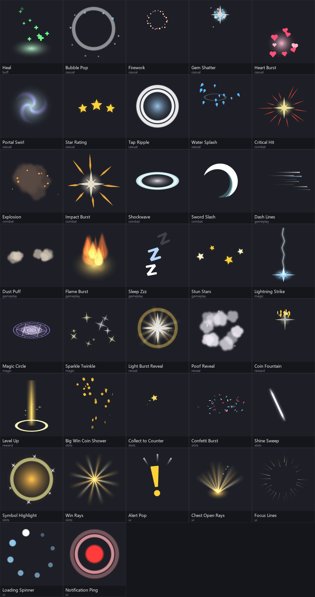

# FX preset catalogue

Every built-in preset of the FX builder (37), at its default settings. Each one is a one-shot effect
(loop it in your game if you need it to repeat); every control in the FX builder changes it.
Previews: `screenshots/fx_presets/<id>.gif`.

## Using them in a game engine

**Generate package** writes Spine 3.8 JSON and loose PNGs for importing into the Spine editor.
**Export for game engine…** writes what the Spine runtimes load: `<name>.json` (Spine 4.0 or 3.8) or
`<name>.skel` (4.0 binary), a packed texture atlas (`<name>.atlas`, or `<name>.atlas.txt` for Unity) and
its PNG page, with optional premultiplied alpha and atlas scale. Use it with spine-unity, spine-godot,
spine-cocos2dx, spine-phaser, spine-pixi, spine-libgdx and the other official runtimes.

To animate an effect further first, insert it into a skeleton in Anim2D (**FX → Insert FX into
skeleton…**), animate it, then use **File → Export…** (JSON or binary with the Texture Packer atlas)
or **File → Unity Bridge…**.

| Preset | Category | Generator | What it is | Preview |
| --- | --- | --- | --- | --- |
| Heal (`heal_rise`) | buff | `rising_particles` | A soft glow at the feet while plus signs float up and fade: healing and buffs. | [GIF](screenshots/fx_presets/heal_rise.gif) |
| Bubble Pop (`bubble_pop`) | casual | `bubble_pop` | A bubble wobbles, swells and bursts into a ring and droplets: bubble shooters, pops, taps. | [GIF](screenshots/fx_presets/bubble_pop.gif) |
| Firework (`firework`) | casual | `firework` | A rocket streaks up and bursts into a ring of sparks that droop and fade: celebrations. | [GIF](screenshots/fx_presets/firework.gif) |
| Gem Shatter (`gem_shatter`) | casual | `shatter` | A tile or gem breaks into shards that burst out, spin and drop: match-3 clears and breaks. | [GIF](screenshots/fx_presets/gem_shatter.gif) |
| Heart Burst (`heart_burst`) | casual | `heart_burst` | Hearts pop out around a point, then float up swaying and fade: likes, lives, love. | [GIF](screenshots/fx_presets/heart_burst.gif) |
| Portal Swirl (`portal_swirl`) | casual | `vortex` | A swirl spins up, sparkles spiral into it, then it collapses with a pop: teleports, collects. | [GIF](screenshots/fx_presets/portal_swirl.gif) |
| Star Rating (`star_rating`) | casual | `star_rating` | Stars pop in one after another along an arc with a bounce and sparkles: level complete. | [GIF](screenshots/fx_presets/star_rating.gif) |
| Tap Ripple (`tap_ripple`) | casual | `ring_wave` | Quick rings spread from a tap or button press over a small glow: UI feedback. | [GIF](screenshots/fx_presets/tap_ripple.gif) |
| Water Splash (`water_splash`) | casual | `splash` | Drops leap up in a crown, arc over and fall, with a ripple: water, juice, puzzles. | [GIF](screenshots/fx_presets/water_splash.gif) |
| Critical Hit (`critical_hit`) | combat | `radial_burst` | A sharper, denser hit burst with thin streaks for critical or heavy hits. | [GIF](screenshots/fx_presets/critical_hit.gif) |
| Explosion (`explosion`) | combat | `explosion` | A bright flash, billowing smoke puffs and flying debris: bombs, blasts, destruction. | [GIF](screenshots/fx_presets/explosion.gif) |
| Impact Burst (`impact_basic`) | combat | `radial_burst` | A short stylized hit: bright flash plus rays that shoot outward and fade. |  |
| Shockwave (`shockwave`) | combat | `ring_wave` | Rings expand from the centre after a quick glow: landings, stomps, ground slams. | [GIF](screenshots/fx_presets/shockwave.gif) |
| Sword Slash (`sword_slash`) | combat | `slash_arc` | A bright crescent sweeps through an arc with fainter trails, for melee swings. | [GIF](screenshots/fx_presets/sword_slash.gif) |
| Dash Lines (`dash_lines`) | gameplay | `dash_lines` | Speed streaks trail behind something moving fast to +X: dashes, sprints, swipes. Mirror for -X. | [GIF](screenshots/fx_presets/dash_lines.gif) |
| Dust Puff (`dust_puff`) | gameplay | `dust_puff` | Puffs of dust kick out along the ground and rise as they fade: landings, jumps, runs, skids. | [GIF](screenshots/fx_presets/dust_puff.gif) |
| Flame Burst (`flame_burst`) | gameplay | `flame_rise` | Tongues of fire lick up from a base over a warm glow: burning, fire damage, torches, campfires. | [GIF](screenshots/fx_presets/flame_burst.gif) |
| Sleep Zzz (`sleep_zzz`) | gameplay | `float_letters` | Z letters float up one after another, growing and swaying: sleeping, idle, bored. | [GIF](screenshots/fx_presets/sleep_zzz.gif) |
| Stun Stars (`stun_stars`) | gameplay | `orbit_stars` | Stars circle above a head on a flat ring, bigger at the front: stunned, dizzy, knocked out. | [GIF](screenshots/fx_presets/stun_stars.gif) |
| Lightning Strike (`lightning_strike`) | magic | `flicker_bolt` | A bolt flickers down from above and flashes where it hits. | [GIF](screenshots/fx_presets/lightning_strike.gif) |
| Magic Circle (`magic_circle`) | magic | `spin_glow` | A rune circle grows on the ground, turns with a counter-turning inner circle, then fades. | [GIF](screenshots/fx_presets/magic_circle.gif) |
| Sparkle Twinkle (`sparkle_twinkle`) | magic | `scatter_pop` | Stars pop up around a point and twinkle out: pickups, shiny items, magic. | [GIF](screenshots/fx_presets/sparkle_twinkle.gif) |
| Light Burst Reveal (`light_reveal`) | reveal | `light_reveal` | Rays burst out and turn, a big flash whites out the centre, a ring spreads: hero or bonus reveals. | [GIF](screenshots/fx_presets/light_reveal.gif) |
| Poof Reveal (`poof_reveal`) | reveal | `poof_reveal` | Smoke bursts out and thins away to reveal a character or symbol, with a flash and sparkles. | [GIF](screenshots/fx_presets/poof_reveal.gif) |
| Coin Fountain (`coin_fountain`) | reward | `particle_spray` | Coins are thrown up in a fan, flip, fall back and fade: rewards and loot. | [GIF](screenshots/fx_presets/coin_fountain.gif) |
| Level Up (`level_up`) | reward | `pillar_burst` | A pillar of light shoots up, a ring spreads at its base and sparkles rise. | [GIF](screenshots/fx_presets/level_up.gif) |
| Big Win Coin Shower (`big_win_coins`) | slots | `coin_rain` | Gold coins pour down across the screen, flipping and turning, with twinkles: big and mega wins. | [GIF](screenshots/fx_presets/big_win_coins.gif) |
| Collect to Counter (`collect_trail`) | slots | `collect_trail` | A star flies along an arc to a target (a counter or meter), leaving sparkles, and pops there. | [GIF](screenshots/fx_presets/collect_trail.gif) |
| Confetti Burst (`confetti_burst`) | slots | `confetti` | Paper strips burst up, flutter, drift and fall in three colours: wins, bonuses, celebrations. | [GIF](screenshots/fx_presets/confetti_burst.gif) |
| Shine Sweep (`shine_sweep`) | slots | `shine_sweep` | A slanted streak of light sweeps across an item, then a sparkle twinkles: coins, gems, buttons. | [GIF](screenshots/fx_presets/shine_sweep.gif) |
| Symbol Highlight (`symbol_glow`) | slots | `pulse_glow` | A glow pulses behind a winning symbol, each pulse sends out a ring, sparkles circle it. | [GIF](screenshots/fx_presets/symbol_glow.gif) |
| Win Rays (`win_rays`) | slots | `rotating_rays` | Soft light rays fan out behind a symbol or prize and turn slowly over a glow. | [GIF](screenshots/fx_presets/win_rays.gif) |
| Alert Pop (`alert_pop`) | ui | `alert_pop` | An exclamation mark pops up with a bounce and a wobble, with emphasis marks: alerts, quests, NPCs. | [GIF](screenshots/fx_presets/alert_pop.gif) |
| Chest Open Rays (`chest_open_rays`) | ui | `fan_burst` | Light rays fan up out of a chest or box over a glow while sparkles rise: rewards, gift boxes. | [GIF](screenshots/fx_presets/chest_open_rays.gif) |
| Focus Lines (`focus_lines`) | ui | `focus_lines` | Manga-style speed lines rush in from the edges toward the centre: big moments, combos, boss intros. | [GIF](screenshots/fx_presets/focus_lines.gif) |
| Loading Spinner (`loading_spinner`) | ui | `orbit_spinner` | Dots on a circle, each smaller and fainter than the last, turning round: waiting and loading. | [GIF](screenshots/fx_presets/loading_spinner.gif) |
| Notification Ping (`notification_ping`) | ui | `badge_ping` | A badge dot bounces in and rings ripple out from it: new items, messages, unread markers. | [GIF](screenshots/fx_presets/notification_ping.gif) |
